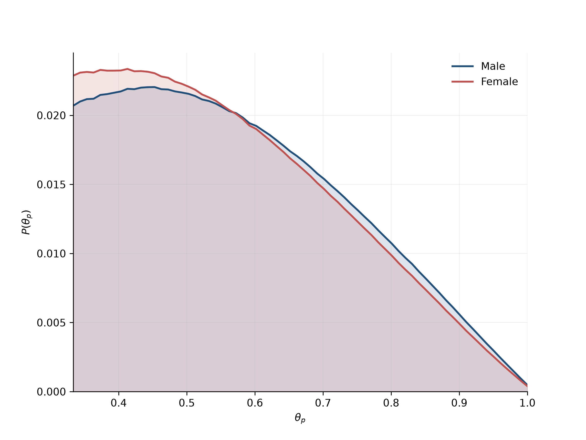

# 🟥 The Chase: How good are players and chasers at head-to-heads?

> **Headline result:** Men show slightly higher performance in the head-to-head rounds compared to women.




## Problem

In *The Chase*, contestants try to beat a quiz expert (the Chaser) to win a cash prize. If a player has a probability of answering a head-to-head question correctly $\theta_p$ and the chaser has the probability $\theta_c$, then given their offer choice $s$ and their winning (or losing) margin of $m$,  what is the posterior distribution for $\theta_p$?


## Key findings

- **Finding 1:** The expected value for $\theta_p$ is 57.87% for men and 56.86% for women 
- **Finding 2:** The expected value for $\theta_c$ is 79.94% for chasers and compared to a expected value of $\theta_p$ of 57.39% for players. 
- **Finding 3:** Shaun Wallace is quite clearly the weakest performer when naively looking at win rate. However, he's the fourth strongest out of six when looking at the expected value of $\theta_c$, and even then, the difference between all of the chasers is slight. 

## Approach

1. **Monte Carlo simulation:** Simulate millions of head-to-head rounds with different levels of player and chaser ability, and offer selected.
2. **Cleaning and exploration:** Downloaded player episodes and clean the data. 
3. **Calculating posteriors:** Given a winning (or losing) margin, find the posterior probabilities for each player, then get the aggregate for all players. 
4. **Calculating posteriors by gender and chaser:** Seperate the posteriors: $\theta_p$ by player gender and $\theta_c$ by chaser. 


## Notebook guide


| # | Notebook | Description |
|---|---|---|
| 1 | [`01_monte_carlo_hth.ipynb`](notebooks/01_monte_carlo_hth.ipynb) | Simulates head-to-heads with different player and chaser accuracies, and offer choices.  |
| 2 | [`02_import_player_results.ipynb`](notebooks/02_import_player_results.ipynb) | Imports player performance information from onequestionshootout.xyz |
| 3 | [`03_posteriors.ipynb`](notebooks/03_posteriors.ipynb) | Calculates posterior probabilities for the player and chaser accuracy |
| 3 | [`04_posteriors_by_gender_and_chaser.ipynb`](notebooks/03_posteriors.ipynb) | Calculates posterior probabilities for the players by gender and chaser by individual chaser |


## Project structure

```
the-chase/
├── README.md
├── LICENSE
├── requirements.txt
├── data/
│   ├── raw/         
│   └── processed/
├── notebooks/
└── figures/

```

## How to reproduce

```bash
# 1. Clone the repo
git clone https://github.com/BenSmithNZL/The-Chase.git
cd [the_chase]

# 2. Create an environment and install dependencies
python -m venv .venv
source .venv/bin/activate        # Windows: .venv\Scripts\activate
pip install -r requirements.txt

# 3. Launch Jupyter and run notebooks 01 to 04 in order
jupyter notebook
```

## Data

- **Source:** [One Question Shootout](https://onequestionshootout.xyz/). Follow them on [X](https://x.com/OneQnShootout). 
- **Coverage:** 9,500+ players across 16 seasons.

## Limitations

- **No number of rounds recorded in head-to-heads:** Makes posterior estimates less precise. 

## Next steps

- **MCMC:** Calculating the posteriors using MCMC to compare results with this approach.
- **Expected value:** Working out the expected value of each offer on the table for the player, based on the amount of money banked (or to be banked) and the probability of winning the final chase. 
- **Risk aversion:** Making inferences about the risk aversion of players based on the offer that they choose. 
- **Optimal strategy:** Is there a strategy that the team members could follow that would maximise the team's winnings? Do most teams cooperate and follow it?

## Stack

Python · pandas · NumPy · scikit-learn · matplotlib · Jupyter

## Licence

This project's code and notebooks are released under the [MIT Licence](LICENSE).

## Contact

**Ben Smith**: [LinkedIn](https://www.linkedin.com/in/ben-smith-806350130) · [GitHub](https://github.com/BenSmithNZL) · [Email](mailto:bsmithnzl108@gmail.com)
